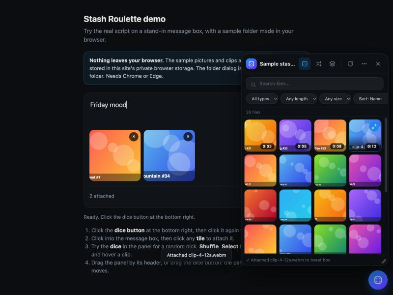

# Stash Roulette

Browse a local folder of photos and videos with previews, then attach any file, or a random one, to the message box on **X** and **Discord**, without touching the native file picker.



> Not affiliated with, endorsed by, or sponsored by X Corp. or Discord Inc. Both names are trademarks of their owners and are used here only to say where the script works.

- **Private by design.** Your files never leave your browser. The script makes no network requests and collects nothing. See [PRIVACY.md](PRIVACY.md).
- **Pick the folder once.** Chrome remembers it between visits.
- **Fast on big folders.** Thumbnails load lazily, video frames are grabbed on demand, and only a few decodes run at a time.

## Try the demo

No account needed. The demo runs the real script on a stand-in message box, with a sample folder of pictures and clips drawn in your browser:

```bash
npm install
npm run build:demo
python3 -m http.server 8000   # then open http://localhost:8000/demo/
```

## Requirements

- A Chromium browser: **Chrome or Edge**. The folder access uses the File System Access API, which Firefox and Safari do not support.
- A userscript manager: [Tampermonkey](https://www.tampermonkey.net/) or [Violentmonkey](https://violentmonkey.github.io/).

## Install

1. Install a userscript manager.
2. Open the latest `stash-roulette.user.js` from the [Releases](../../releases) page (the manager offers to install it).
3. Open x.com or discord.com, click the floating dice button, and pick your media folder. If Chrome offers "Allow on every visit", accept it.

## Use

| Action | How |
|---|---|
| Open or close the panel | Click the dice button, or `Alt+Shift+M` |
| Attach a file | Click a tile |
| Attach a random file | Dice button in the panel, or `Alt+Shift+R` (avoids repeating recent picks) |
| Attach several files | Select mode (layers icon) or ⌘/Ctrl-click, up to 4, then **Attach** |
| Big preview | Hover a tile, click the expand button; `←` `→` move, `Enter` attaches, `Esc` closes |
| Search, filter, sort | Search box, then Type, Length, Size and Sort chips. Reset appears when a filter is active |
| Shuffle | Shuffle button or `Alt+Shift+S`. The order is saved |
| Rescan | Refresh button. New files appear at the top |
| Change folder, reset position | ⋯ menu |
| Move | Drag the panel by its header, or drag the dice button. The panel hides while you drag the button |
| Resize | Drag the bottom-right corner |

On Discord the size filter defaults to 10 MB, the free upload limit.

## Good to know

- Click into the message box once before attaching; the script remembers it.
- X and Discord change their pages often. If attaching stops working after a site update, please [open an issue](../../issues/new/choose) with the site, browser and what you clicked.
- Subfolders are not scanned yet.

## Build from source

```bash
npm install
npm run check       # typecheck, lint, tests, build
npm run build       # dist/stash-roulette.user.js
```

See [CONTRIBUTING.md](CONTRIBUTING.md) and [docs/ARCHITECTURE.md](docs/ARCHITECTURE.md).

## License

[MIT](LICENSE)
